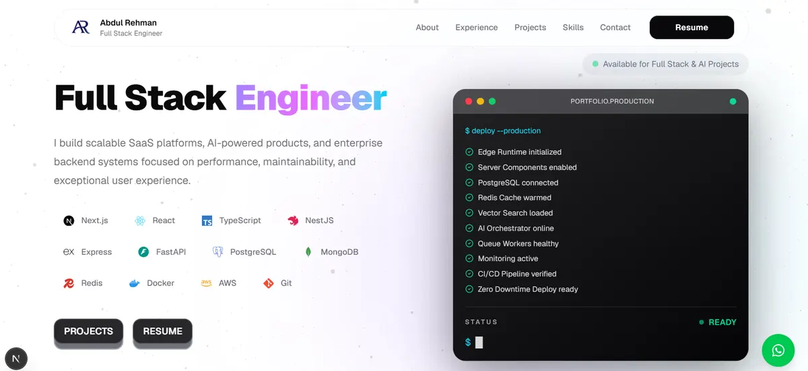

<div align="center">

# Abdul Rehman

### Full Stack Developer • TypeScript • Next.js • React

<p>
Building modern, scalable, and high-performance web applications with a strong focus on user experience, clean architecture, and elegant design.
</p>

<p>
<a href="https://abdulfullstackdev.vercel.app">

</a>
<a href="https://github.com/abdul0325">

</a>
</p>

</div>

---

<p align="center">

</p>

---

# About

This repository contains the source code for my personal developer portfolio.

The portfolio is designed to showcase my professional experience, technical skills, featured projects, and provide an easy way for clients and recruiters to get in touch.

The primary goal was to create a portfolio that is:

- Modern
- Fast
- Responsive
- Accessible
- Minimal
- Highly interactive

Every section has been carefully crafted with smooth animations, reusable components, and clean architecture to deliver a premium user experience.

---

# Features

✨ Modern responsive UI

✨ Beautiful animations powered by Framer Motion

✨ Clean and reusable component architecture

✨ Fully responsive across all devices

✨ Interactive project showcase

✨ Skills & technology section

✨ Integrated EmailJS contact form

✨ WhatsApp quick contact

✨ Smooth scrolling navigation

✨ SEO friendly

✨ Optimized performance

✨ Built with TypeScript

---

# Tech Stack

| Category | Technology |
|----------|------------|
| Framework | Next.js |
| Language | TypeScript |
| UI | React |
| Styling | Tailwind CSS |
| Animation | Framer Motion |
| Icons | Lucide React • React Icons |
| Email | EmailJS |
| Deployment | Vercel |

---

# Project Structure

```text
src
│
├── app
├── components
│   ├── about
│   ├── contact
│   ├── footer
│   ├── hero
│   ├── navbar
│   ├── projects
│   ├── skills
│   └── ui
│
├── data
├── hooks
├── lib
├── styles
└── utils

public
│
├── preview.webp
├── projects
├── resume
└── images
```

---

# Getting Started

Clone the repository

```bash
git clone https://github.com/abdul0325/FullStackWeb.git
```

Move into the project

```bash
cd Portfolio-Website
```

Install dependencies

```bash
npm install
```

Start the development server

```bash
npm run dev
```

Open

```
http://localhost:3000
```

---

# Highlights

- Premium UI/UX
- Smooth page transitions
- Mobile-first responsive design
- Reusable component system
- Elegant typography
- Interactive contact form
- Fast loading experience
- Clean folder architecture
- Production-ready codebase

---

# Contact

I'm currently available for:

- Freelance Projects
- Full-time Opportunities
- Remote Work
- Open Source Collaboration

### Email

**abdulrehman.fullstackdev@gmail.com**

### Portfolio

https://abdulfullstackdev.vercel.app

### LinkedIn

https://www.linkedin.com/in/abdul-rehman-961428265/

### GitHub

https://github.com/abdul0325

---

# Deployment

This portfolio is deployed on **Vercel**.

Every push to the main branch automatically triggers a new production deployment.

Live Website

https://abdulfullstackdev.vercel.app

---

# License

This project is licensed under the MIT License.

You are free to fork, modify, and use it for learning or inspiration.

---

<div align="center">

## Thank you for visiting!

If you like this project, consider giving it a ⭐ on GitHub.

Made with ❤️ by **Abdul Rehman**

</div>